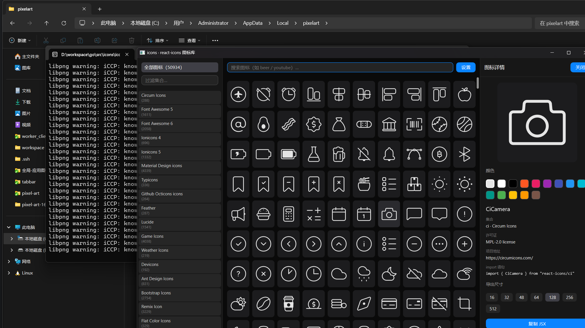
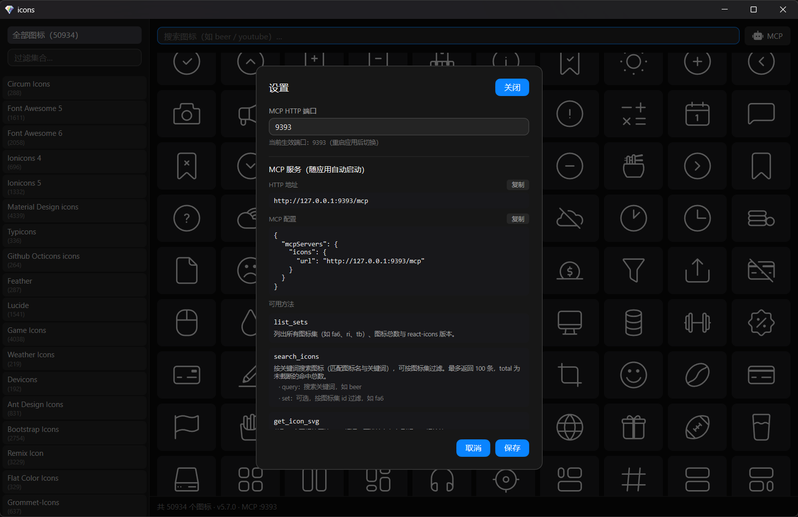

<p align="center">
  
</p>

<h1 align="center">icons · UI图标库</h1>

<p align="center">中文 | <a href="README_EN.md">English</a></p>

<p align="center">
  <a href="https://github.com/limengwei/icons/releases/latest"></a>
</p>

<p align="center">
基于 <a href="https://github.com/react-icons/react-icons">react-icons</a> 的桌面图标浏览器与检索工具——31 个图标集、50,934 个矢量图标，全部内嵌于单个可执行文件。<br>
内置 MCP 服务器，可接入 AI 助手使用。
</p>

## 截图

<p align="center">
  
</p>
<p align="center">
  
</p>

## 功能特性

- **图标浏览** — 虚拟滚动网格 + 矢量渲染（任意缩放与 DPI 下清晰）；全部图标编译进二进制，无需下载，无首次部署
- **即时搜索** — 图标名与集合关键词的防抖子串搜索；结果超过 10,000 行时截断并在状态栏提示
- **集合侧栏** — 全部 31 个图标集（Font Awesome 6、Material Design、Tabler、Phosphor、Grommet 等）及实时数量
- **详情与导出** — 棋盘格放大预览、SVG 一键复制、任意尺寸与颜色的 PNG 导出与剪贴板复制
- **MCP 服务** — 内嵌 MCP 服务器（stdio + HTTP），供 AI 工具检索图标、获取 SVG、渲染 PNG
- **托盘常驻** — 关闭窗口最小化到系统托盘，MCP 服务后台继续运行；TCP 端口锁保证单实例

## 技术栈

| 层 | 技术 |
|----|------|
| 语言 | Go |
| 桌面框架 | [nsgo](https://github.com/nsgo-dev/nsgo)（暗色外观、托盘） |
| 数据集 | [react-icons](https://github.com/react-icons/react-icons) v5.7.0，内嵌（按集合 gzip JSON） |
| MCP | [modelcontextprotocol/go-sdk](https://github.com/modelcontextprotocol/go-sdk) |

## MCP 集成

内嵌 MCP HTTP 服务器随应用自动启动（默认端口 9393，可在设置中修改）。也可以运行 `icons --mcp` 启动独立的 stdio 服务器。

**关闭窗口不会退出应用**：最小化到系统托盘并继续提供 MCP 服务。点击托盘图标恢复窗口，右键菜单提供「显示窗口 / 退出」。

### 可用工具

| 工具 | 说明 |
|------|------|
| `list_sets` | 列出所有图标集（fa6、ri、tb 等）、图标总数与 react-icons 版本 |
| `search_icons` | 按关键词搜索图标（图标名 + 集合关键词），可按集合过滤；最多返回 100 条，附未截断总数 |
| `get_icon_svg` | 获取图标原始 SVG 标记，可选注入 CSS 颜色到根 `fill` |
| `export_icon_png` | 渲染图标为 PNG（base64 返回），可指定尺寸（默认 256）与颜色 |

### 客户端配置

添加到 MCP 客户端配置（如 Claude Desktop、Cursor）：

```json
{
  "mcpServers": {
    "icons": {
      "url": "http://127.0.0.1:9393/mcp"
    }
  }
}
```

## 构建与开发

```bash
go tool nsgo dev            # 开发运行
go tool nsgo build          # 发布构建 -> dist/releases/
go test ./internal/...
```

纯 `go build` 也可用；图标资源来自 `rsrc_windows_amd64.syso`。

Windows CI 每次推送通过 `go tool nsgo build` 构建 NSIS 安装包，并在 `v*` 标签上发布（见 [.github/workflows/build-windows.yml](.github/workflows/build-windows.yml)）。

## 许可

- 代码：[MIT](LICENSE) © 2026 limengwei
- 图标：react-icons 各集合遵循各自许可（MIT / CC BY / SIL OFL / Apache 2.0，应用内「设置 → 数据来源」可查看集合列表）
